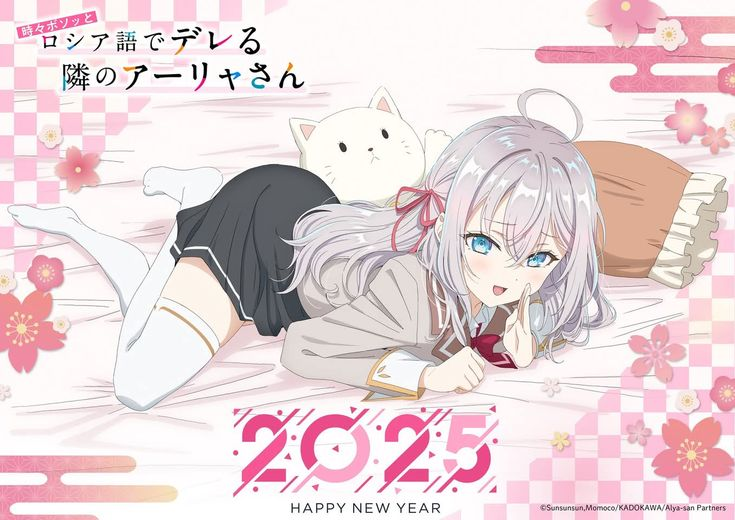

  

### Oi, eu sou o lorizvendedpr 🌸

Meu espaço para código, ideias e projetos.

**Alya Kujou vibes · um commit de cada vez.**

<a href="https://github.com/lorizvendedpr?tab=repositories">📁 Repositórios</a>
&nbsp; · &nbsp;
<a href="https://github.com/lorizvendedpr?tab=stars">✨ Favoritos</a>

  

✦ &nbsp; 🌸 &nbsp; ✦

### 🩵 Pelo meu GitHub

| Projeto | Abrir |
| :--- | :--- |
| 🎮 **My First Arcade** | [Ver repositório →](https://github.com/lorizvendedpr/my-first-arcade) |
| 🎀 **Kujou Vendas** | [Ver repositório →](https://github.com/lorizvendedpr/Kujou-Vendas) |
| 💻 **Todos os projetos** | [Explorar →](https://github.com/lorizvendedpr?tab=repositories) |

 

🌸 Mais um pouco de Alya

 

  

 

  <b>🤍 Obrigado pela visita 🤍</b> 
  Alya Kujou · ロシデレ · fan theme

